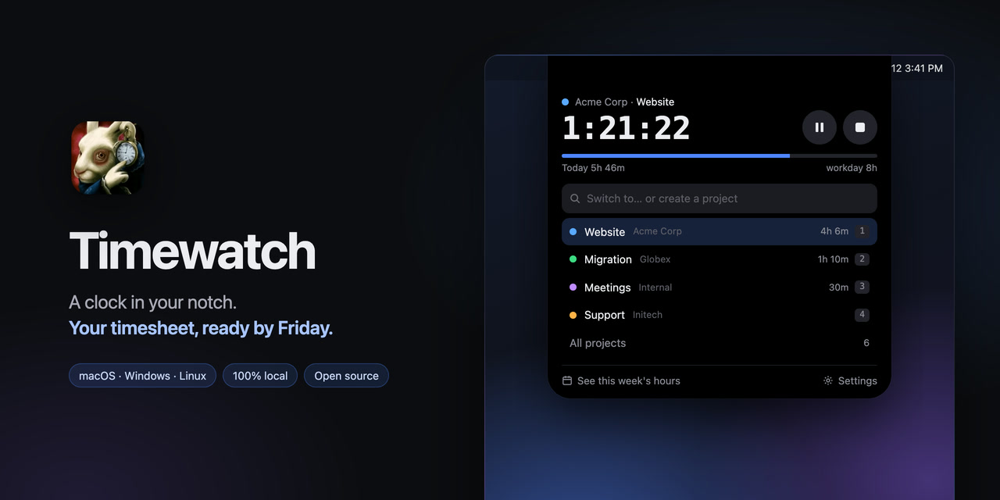
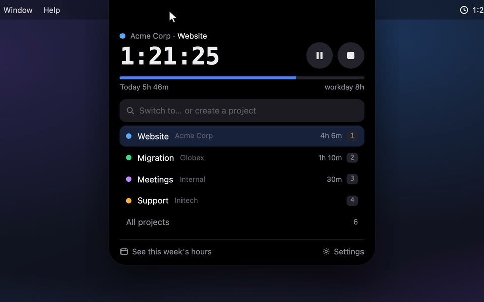
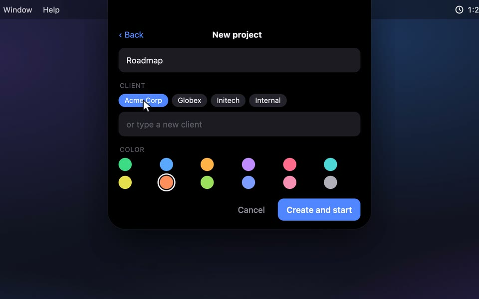
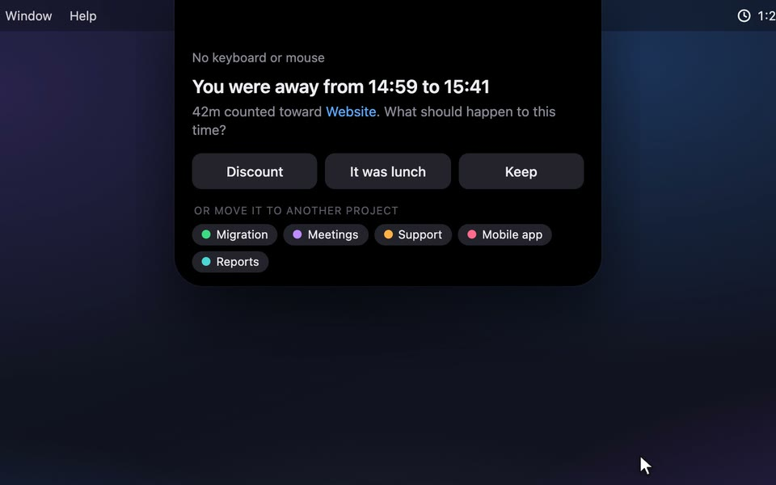
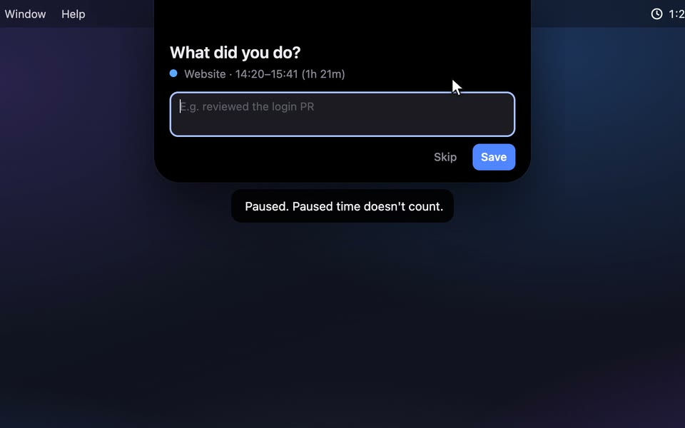
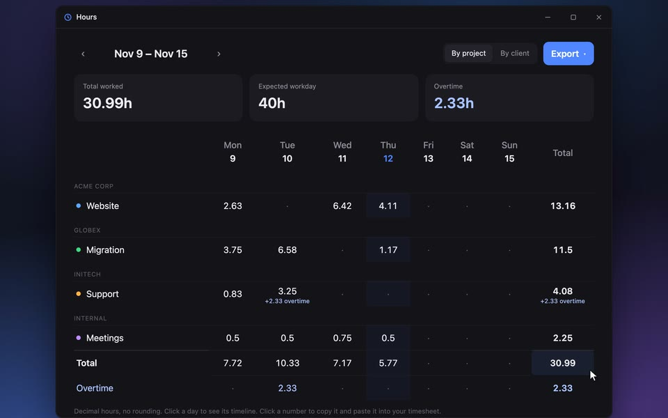
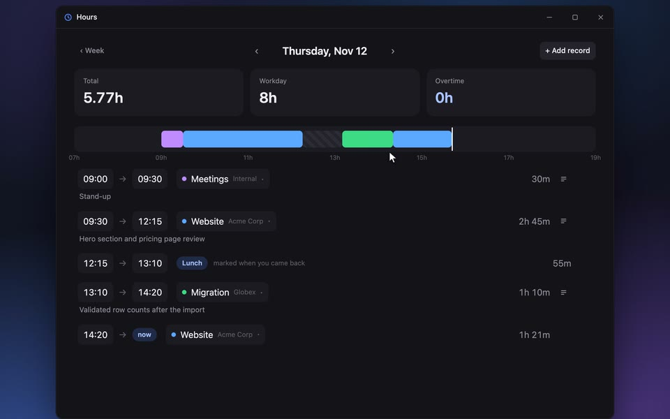
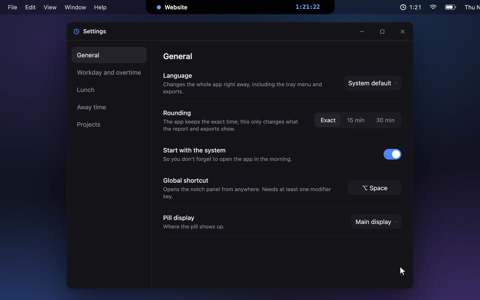
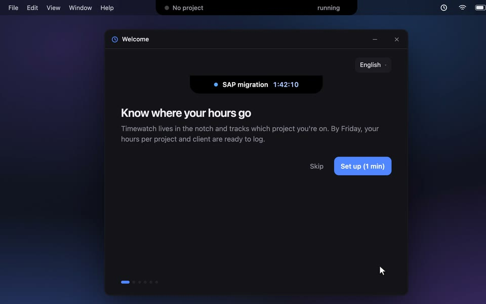

<p align="center">
  
</p>

<p align="center">
  <a href="https://github.com/dbx0/timewatch/stargazers"></a>
  <a href="https://github.com/dbx0/timewatch/releases"></a>
  
  
  
</p>

<p align="center">
  <strong>The time tracker that lives in your notch.</strong><br/>
  Switch projects with one click or a shortcut, and by Friday your hours per project and client are ready for your timesheet.<br/>
  It runs on your machine, with no account and no network.
</p>

<h3 align="center"><a href="https://github.com/dbx0/timewatch/releases/latest"><ins>Download Timewatch</ins></a> · <a href="docs/assets/demo.mp4"><ins>Watch the demo</ins></a></h3>

<p align="center">
  <picture>
    <source srcset="docs/assets/hero.gif" type="image/gif" />
    
  </picture>
</p>


## Why Timewatch

If you work for several clients in the same week, your day is a string of blocks: two hours on one project, a call for another, a quick fix for a third. None of those switches leave a trace, so on Friday you rebuild the week from chat history and calendar invites to fill in the company timesheet.

Timewatch records the switch when it happens. A clock sits in the Mac notch (on Windows and Linux, a thin strip at the top of the screen), and changing projects takes a click or a couple of keys, without opening a window. It works out your workday, lunch and overtime, and the weekly report is ready to copy or export.

## Features

### A clock in the notch

The pill shows the running project and the session time. Rest the pointer on it and the panel unfolds: switch to a recent project, search all of them, or type a new name to create one on the spot. Passing over the top of the screen does not open it, and opening it by hover never steals the keyboard from what you are typing.

The global shortcut (<kbd>⌥</kbd> <kbd>Space</kbd> on macOS, <kbd>Ctrl</kbd> <kbd>Alt</kbd> <kbd>Space</kbd> elsewhere) opens it with the search focused. With the panel open, <kbd>1</kbd> to <kbd>4</kbd> switch to your recent projects, <kbd>Space</kbd> pauses or resumes, and <kbd>Esc</kbd> closes it.

<p align="center">
  <picture>
    <source srcset="docs/assets/features/notch.gif" type="image/gif" />
    
  </picture>
</p>

### It asks about time away, and never discounts on its own

When you leave the computer with the clock running (no keyboard or mouse for a while, the laptop asleep, or the screen locked), the notch opens by itself when you come back and asks what to do with that time: discount it, mark it as lunch, keep it, or move it to another project. A 40 minute video call without touching the keyboard stays yours unless you say otherwise, and every answer can be undone.

<p align="center">
  <picture>
    <source srcset="docs/assets/features/absence.gif" type="image/gif" />
    
  </picture>
</p>

### "What did you do?"

Pause or stop from the notch and it asks for a one line note about the block you just closed. Press Enter to save it, or skip it and add it later from the day view. The notes show up under each entry in the day view and in the detailed HTML export.

<p align="center">
  <picture>
    <source srcset="docs/assets/features/note.gif" type="image/gif" />
    
  </picture>
</p>

### A week you can paste into your timesheet

The report window shows the week in decimal hours, per project or per client, with regular time and overtime apart. Click any number and it is copied in the format your timesheet expects. Export the week to CSV for a spreadsheet or to HTML for a printable report, optionally with the start and end of every entry.

<p align="center">
  <picture>
    <source srcset="docs/assets/features/week.gif" type="image/gif" />
    
  </picture>
</p>

### Every day on a timeline

Click a day to see it as a timeline, with lunch and the current time marked. Fix a start or end time, move an entry to another project, add a note or delete it (with undo). A note under the list explains how lunch was handled that day.

<p align="center">
  <picture>
    <source srcset="docs/assets/features/day.gif" type="image/gif" />
    
  </picture>
</p>

<table>
<tr>
<td width="50%" valign="middle">

### Your workday, your rules

Set the workday per weekday, mark holidays, pick how long lunch is and when you usually have it, how long away counts as away, and whether hours round to 15 or 30 minutes. Projects can be renamed, recolored, archived or deleted.

</td>
<td width="50%">
  <picture><source srcset="docs/assets/features/settings.gif" type="image/gif" /></picture>
</td>
</tr>
<tr>
<td width="50%" valign="middle">

### Set up in a minute

The first run asks for your clients and projects, your workday, lunch and rounding, then starts the clock on the project you are working on. A tip points at the notch so you know where the clock went.

</td>
<td width="50%">
  <picture><source srcset="docs/assets/features/onboarding.gif" type="image/gif" /></picture>
</td>
</tr>
</table>

| | |
|---|---|
| **Lunch, handled** | Mark an absence as lunch, or let the app discount your usual lunch duration from the project running at your usual lunch time once the day is over. |
| **Overtime** | Hours past the day's workday count as overtime for the project running at that moment. Weekends and holidays at 0h are all overtime. |
| **Rounding** | Exact, 15 or 30 minutes. The exact time is always stored, rounding only changes the report and exports, and totals are sums of the rounded cells so they always add up. |
| **Undo** | Stopping, deleting an entry or a project, unmarking lunch and every answer to the away question can be undone. |
| **Never loses time** | The clock lives in the Rust backend and is written to disk as it runs. If the app closes with the clock running, it stops at the last moment it was alive and tells you. |
| **Three languages** | English, Brazilian Portuguese and Spanish, following the system language unless you pick one. |

## Your data stays on your machine

Timewatch has no backend and no account. Everything is kept in a single SQLite file, `timewatch.sqlite3`, in the app's data folder (identifier `dev.timewatch.desktop`):

| OS | Data folder |
|---|---|
| macOS | `~/Library/Application Support/dev.timewatch.desktop/` |
| Windows | `%APPDATA%\dev.timewatch.desktop\` |
| Linux | `~/.local/share/dev.timewatch.desktop/` |

Older builds used the identifier `dev.timewatch.app`. On first run the database is copied from there automatically, and the old copy is left in place as a backup.

The app makes no network calls and has no telemetry. To back it up, copy the file while the app is closed.

## Install

Grab the build for your platform from the [latest release](https://github.com/dbx0/timewatch/releases/latest):

| Platform | Download |
|---|---|
| macOS 12 or later (Apple silicon and Intel) | `.dmg` (universal) |
| Windows | `-setup.exe` or `.msi` |
| Linux (experimental) | `.AppImage`, `.deb` or `.rpm` |

The builds are not signed by Apple or Microsoft.

**macOS:** open the `.dmg` and drag Timewatch to Applications. The first time, right-click the app and choose Open. If Gatekeeper still blocks it:

```sh
xattr -dr com.apple.quarantine /Applications/Timewatch.app
```

**Windows:** run the installer. If SmartScreen warns you, click "More info" and then "Run anyway".

**Linux (experimental):** use the `.AppImage` (`chmod +x` it and run it), the `.deb` or the `.rpm`. It needs WebKitGTK 4.1 and, for the tray icon, a panel with AppIndicator support. There is no idle detection on Linux yet, so the away question only appears after the system sleeps.

## Build from source

You need Node 22, pnpm, stable Rust and the [Tauri 2 prerequisites](https://tauri.app/start/prerequisites/) for your OS.

```sh
pnpm i
pnpm tauri dev
```

Run the tests with:

```sh
pnpm vitest run
(cd src-tauri && cargo test)
```

In debug builds, autostart is off unless `TIMEWATCH_DEV_AUTOSTART=1`, and `TIMEWATCH_DATA_DIR=/some/path` points the app at another data folder (debug builds only).

`pnpm tauri build` writes the installers to `src-tauri/target/release/bundle/`. For the universal macOS build used in CI:

```sh
rustup target add x86_64-apple-darwin aarch64-apple-darwin
pnpm tauri build --target universal-apple-darwin
```

The `.github/workflows/build.yml` workflow runs the tests and builds on `macos-latest`, `windows-latest` and `ubuntu-22.04` on every push and pull request. A `v*` tag creates a draft release with the installers.

`pnpm readme:assets` regenerates the images and videos in `docs/assets` (it needs ffmpeg). The README videos and screenshots are rendered from the real UI with fictional data.

How the pieces fit together, and the known limitations, are in [docs/ARCHITECTURE.md](docs/ARCHITECTURE.md) (in Portuguese).

## License

MIT. See [LICENSE](LICENSE).
